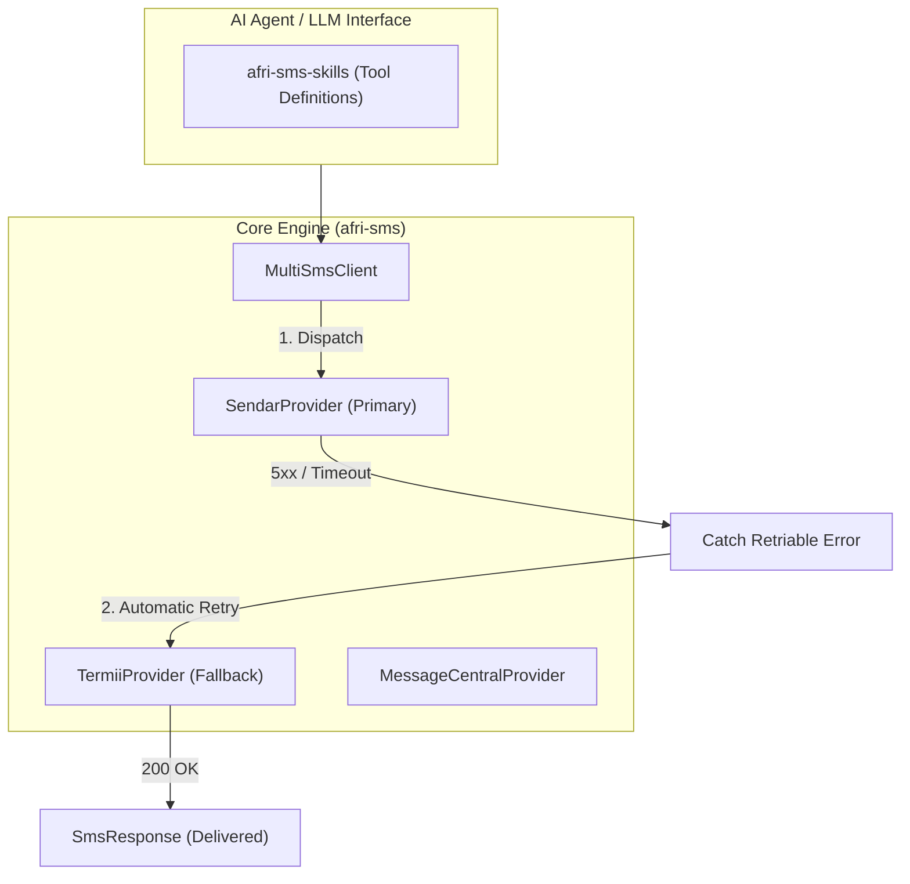

# afri-sms (Workspace)

[](https://crates.io/crates/afri-sms)
[](https://docs.rs/afri-sms)
[](Cargo.toml)

An asynchronous, highly-optimized Rust Cargo Workspace providing unified SMS/OTP adapter gateways for African telecom providers with automated fallback routing, alongside LLM agent tool definitions.

---

## Workspace Member Crates

| Crate | Path | Description |
| :--- | :--- | :--- |
| [**`afri-sms`**](crates/afri-sms) | `crates/afri-sms` | Core library crate: `SmsProvider` trait, normalized `SmsResponse`, `SmsError`, provider adapters (Sendar, Termii, Message Central), and `MultiSmsClient` fallback engine. |
| [**`afri-sms-skills`**](crates/afri-sms-skills) | `crates/afri-sms-skills` | LLM agent tool definitions, function calling schemas, and prompt structs for autonomous AI integration. |

---

## Architecture



---

## Installation

Add either member crate to your `Cargo.toml`:

```toml
[dependencies]
# For core SMS routing and provider adapters:
afri-sms = "0.1.1"

# For LLM agent tool schemas:
afri-sms-skills = "0.1.0"

# Async runtime:
tokio = { version = "1.0", features = ["macros", "rt-multi-thread"] }
```

---

## Quick Start: Multi-Provider Fallback Routing

```rust
use afri_sms::{MultiSmsClient, SendarProvider, TermiiProvider, SmsError};

#[tokio::main]
async fn main() -> Result<(), SmsError> {
    // 1. Build primary and fallback providers
    let primary = SendarProvider::builder()
        .api_key(std::env::var("SENDAR_API_KEY").unwrap())
        .sender_id("BankAlert")
        .route("transactional")
        .build()?;

    let fallback = TermiiProvider::builder()
        .api_key(std::env::var("TERMII_API_KEY").unwrap())
        .sender_id("BankAlert")
        .channel("dnd")
        .build()?;

    // 2. Wrap into MultiSmsClient
    let client = MultiSmsClient::builder()
        .primary(primary)
        .with_fallback(fallback)
        .build()?;

    // 3. Dispatch SMS with automatic secondary fallback routing
    let response = client
        .send_sms("+2348012345678", "Your verification code is 482910.")
        .await?;

    println!("Delivered via {} (Message ID: {})", response.provider, response.message_id);
    Ok(())
}
```

---

## Supported Providers

| Provider | Gateway Type | Auth Mechanism | Default Route |
| :--- | :--- | :--- | :--- |
| **Sendar** | Modern REST JSON | Header `API-KEY` | Transactional |
| **Termii** | Nigerian Industry Standard | Body `api_key` | DND / Transactional |
| **Message Central** | Multi-channel CPaaS | Header `authToken` | SMS (OTP / Alerts) |

---

## Contributing

Contributions are welcomed!
1. Ensure all public functions, structs, and traits have doc-comments with runnable doctests.
2. Adhere to **Conventional Commits** (`feat:`, `fix:`, `docs:`, `chore:`).
3. Run `cargo fmt --check` and `cargo clippy --workspace --all-targets -- -D warnings`.
4. Ensure all tests pass (`cargo test`).

---

## License

Dual-licensed under either:
* Apache License, Version 2.0 ([LICENSE-APACHE](LICENSE-APACHE) or http://www.apache.org/licenses/LICENSE-2.0)
* MIT license ([LICENSE-MIT](LICENSE-MIT) or http://opensource.org/licenses/MIT)
