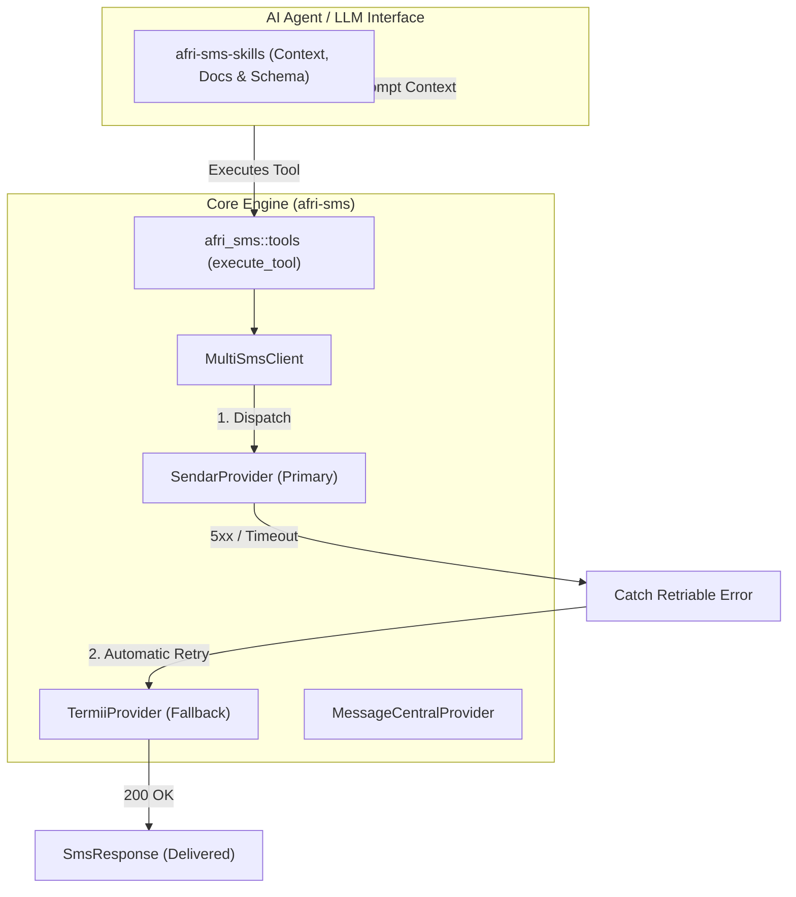

# afri-sms (Workspace)

[](https://crates.io/crates/afri-sms)
[](https://docs.rs/afri-sms)
[](Cargo.toml)

An asynchronous, highly-optimized Rust Cargo Workspace providing unified SMS/OTP adapter gateways for African telecom providers with automated fallback routing, alongside LLM agent tool definitions.

---

## Workspace Member Crates

| Crate | Path | Description |
| :--- | :--- | :--- |
| [**`afri-sms`**](crates/afri-sms) | `crates/afri-sms` | Core library crate: `SmsProvider` trait, normalized `SmsResponse`, `SmsError`, provider adapters (Sendar, Termii, Message Central), `MultiSmsClient` fallback engine, and `afri_sms::tools` execution engine. |
| [**`afri-sms-skills`**](crates/afri-sms-skills) | `crates/afri-sms-skills` | Agentic documentation, prompt context, JSON tool schemas, and repository scaffolding CLI (`afri-sms-skills init`) for autonomous AI coding agents. |

---

## Architecture



---

## Installation

```toml
[dependencies]
# For core SMS routing, providers, and tool execution:
afri-sms = "0.1.2"

# (Optional) For agent orchestrators needing programmatic access to documentation & prompt context:
afri-sms-skills = "0.1.2"

# Async runtime:
tokio = { version = "1.0", features = ["macros", "rt-multi-thread"] }
```

---

## Quick Start: Multi-Provider Fallback Routing

```rust
use afri_sms::{MultiSmsClient, SendarProvider, TermiiProvider, SmsError};

#[tokio::main]
async fn main() -> Result<(), SmsError> {
    // 1. Build primary and fallback providers
    let primary = SendarProvider::builder()
        .api_key(std::env::var("SENDAR_API_KEY").unwrap())
        .sender_id("BankAlert")
        .route("transactional")
        .build()?;

    let fallback = TermiiProvider::builder()
        .api_key(std::env::var("TERMII_API_KEY").unwrap())
        .sender_id("BankAlert")
        .channel("dnd")
        .build()?;

    // 2. Wrap into MultiSmsClient
    let client = MultiSmsClient::builder()
        .primary(primary)
        .with_fallback(fallback)
        .build()?;

    // 3. Dispatch SMS with automatic secondary fallback routing
    let response = client
        .send_sms("+2348012345678", "Your verification code is 482910.")
        .await?;

    println!("Delivered via {} (Message ID: {})", response.provider, response.message_id);
    Ok(())
}
```

---

## Supported Providers & Key Use Cases

| Provider / Module | Key Capabilities & Use Cases | Primary APIs |
| :--- | :--- | :--- |
| **`MultiSmsClient`** | Automated secondary fallback routing on 5xx outages & timeouts | `MultiSmsClient::builder()`, `send_sms()` |
| **`SendarProvider`** | High-throughput transactional SMS & real-time delivery status | `SendarProvider::builder()`, `get_message_status()` |
| **`TermiiProvider`** | Auto `+` stripping, dynamic SMS OTP PINs & zero-cost in-app tokens | `send_sms()`, `send_token()`, `generate_in_app_token()` |
| **`MessageCentralProvider`** | CPaaS SMS, auto dialing code parsing, Verify Now V3 OTP lifecycle | `send_sms()`, `send_otp()`, `validate_otp()` |
| **`afri_sms::tools`** | LLM agent function calling schema & runtime tool execution | `send_sms_tool_definition()`, `execute_tool()` |

> [!TIP]
> A comprehensive, executable showcase covering all five use cases is available in [`demo.rs`](demo.rs). Run it via:
> ```bash
> cargo run -p afri-sms --example demo
> ```

---

## Contributing

Contributions are welcomed!
1. Ensure all public functions, structs, and traits have doc-comments with runnable doctests.
2. Adhere to **Conventional Commits** (`feat:`, `fix:`, `docs:`, `chore:`).
3. Run `cargo fmt --check` and `cargo clippy --workspace --all-targets -- -D warnings`.
4. Ensure all tests pass (`cargo test`).

---

## License

Dual-licensed under either:
* Apache License, Version 2.0 ([LICENSE-APACHE](LICENSE-APACHE) or http://www.apache.org/licenses/LICENSE-2.0)
* MIT license ([LICENSE-MIT](LICENSE-MIT) or http://opensource.org/licenses/MIT)
