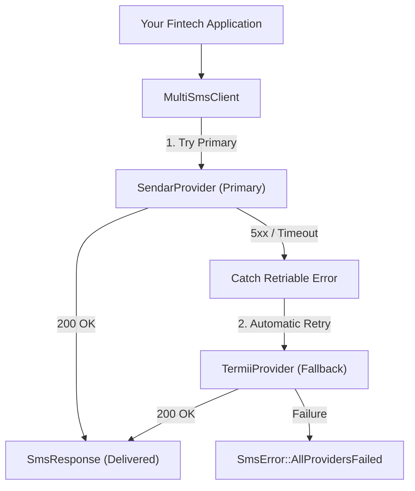

# afri-sms

[](https://crates.io/crates/afri-sms)
[](https://docs.rs/afri-sms)
[](Cargo.toml)

An asynchronous, highly-optimized Rust library crate providing a unified adapter interface for African telecom and SMS aggregators with automated fallback routing.

---

## Table of Contents

- [Overview](#overview)
- [Architecture](#architecture)
- [Supported Providers](#supported-providers)
- [Installation](#installation)
- [Quick Start](#quick-start)
- [Fallback Engine Routing](#fallback-engine-routing)
- [Provider Configurations](#provider-configurations)
  - [Sendar](#sendar)
  - [Termii](#termii)
  - [Message Central](#message-central)
- [Error Handling](#error-handling)
- [Performance & Security](#performance--security)
- [Contributing](#contributing)
- [License](#license)

---

## Overview

African telecom and messaging ecosystems are notoriously fragmented:
* **Inconsistent Authentication:** Some APIs expect `Authorization: Bearer <token>` HTTP headers, some pass `api_key` within the JSON body, while others require query-based or custom authentication headers.
* **Non-Standardized Payloads:** Parameter names vary wildly (`to` vs `mobileNumber`, `sms` vs `message`, `from` vs `senderId`).
* **Gateway Unreliability:** Downtime, latency spikes, and transient 5xx server errors frequently drop critical OTP and transactional alerts.

`afri-sms` solves this by applying the **Adapter (Facade) Pattern** over African telecom gateways and pairing it with an **Automated Fallback Engine** that detects transient upstream failures and instantly reroutes messages to secondary providers.

---

## Architecture



---

## Supported Providers (V1)

| Provider | Gateway Type | Auth Mechanism | Default Route |
| :--- | :--- | :--- | :--- |
| **Sendar** | Modern REST JSON | `Authorization: Bearer <key>` | Transactional |
| **Termii** | Nigerian Industry Standard | Body `api_key` | DND / Transactional |
| **Message Central** | Multi-channel CPaaS | Header `authToken` | SMS (OTP / Alerts) |

---

## Installation

Add `afri-sms` and `tokio` to your `Cargo.toml`:

```toml
[dependencies]
afri-sms = "0.1.0"
tokio = { version = "1.0", features = ["macros", "rt-multi-thread"] }
```

---

## Quick Start

```rust
use afri_sms::{MultiSmsClient, SendarProvider, TermiiProvider, SmsError};

#[tokio::main]
async fn main() -> Result<(), SmsError> {
    // 1. Initialize primary and fallback providers
    let primary = SendarProvider::builder()
        .api_key("sendar_live_secret")
        .sender_id("BankAlert")
        .route("transactional")
        .build()?;

    let fallback = TermiiProvider::builder()
        .api_key("termii_live_secret")
        .sender_id("BankAlert")
        .channel("dnd")
        .build()?;

    // 2. Wrap them into the resilient MultiSmsClient
    let client = MultiSmsClient::builder()
        .primary(primary)
        .with_fallback(fallback)
        .build()?;

    // 3. Dispatch SMS with automatic fallback routing
    let response = client
        .send_sms("+2348012345678", "Your login verification code is 482910.")
        .await?;

    println!("Delivered via: {} (Message ID: {})", response.provider, response.message_id);
    Ok(())
}
```

---

## Fallback Engine Routing

The fallback engine in `MultiSmsClient` is engineered specifically for mission-critical fintech workflows:

1. **Transient Failures (Fallback Triggered):**
   - HTTP 500, 502, 503, 504 server gateway errors
   - Network transport errors (DNS lookup timeout, connection drops, socket timeouts)
2. **Deterministic Client Errors (No Wasted Retries):**
   - HTTP 400 (`SmsError::InvalidPhoneNumber`, `SmsError::InvalidRequest`)
   - HTTP 401 / 403 (`SmsError::AuthenticationFailed`)
   - HTTP 402 (`SmsError::InsufficientBalance`)
   *These errors abort immediately without attempting the secondary provider, saving API credits and execution latency.*

---

## Provider Configurations

### Sendar

```rust
use afri_sms::SendarProvider;

let sendar = SendarProvider::builder()
    .api_key(std::env::var("SENDAR_API_KEY").unwrap())
    .sender_id("PayQuick")
    .route("transactional")
    .build()?;
```

### Termii

```rust
use afri_sms::TermiiProvider;

let termii = TermiiProvider::builder()
    .api_key(std::env::var("TERMII_API_KEY").unwrap())
    .sender_id("PayQuick")
    .channel("dnd") // "dnd" for transactional, "generic" for promotional
    .build()?;
```

### Message Central

```rust
use afri_sms::MessageCentralProvider;

let mc = MessageCentralProvider::builder()
    .auth_token(std::env::var("MESSAGE_CENTRAL_AUTH_TOKEN").unwrap())
    .sender_id("PayQuick")
    .default_country_code("234") // Default international code (Nigeria)
    .flow_type("SMS") // "SMS" or "WHATSAPP"
    .build()?;
```

---

## Error Handling

All provider-specific quirks and responses are normalized into [`SmsError`](src/error.rs):

```rust
use afri_sms::{MultiSmsClient, SmsError};

match client.send_sms("+2348012345678", "Hello Africa!").await {
    Ok(res) => println!("Sent: {} [{}]", res.message_id, res.provider),
    Err(SmsError::InvalidPhoneNumber { phone_number, reason }) => {
        eprintln!("Invalid recipient {}: {}", phone_number, reason);
    }
    Err(SmsError::InsufficientBalance(msg)) => {
        eprintln!("Alert: Provider balance empty: {}", msg);
    }
    Err(SmsError::AllProvidersFailed { primary, fallback }) => {
        eprintln!("CRITICAL: Primary ({:?}) and Fallback ({:?}) both failed!", primary, fallback);
    }
    Err(err) => eprintln!("Unhandled error: {}", err),
}
```

---

## Performance & Security

* **Zero-Cost Abstractions:** Avoids unnecessary buffer copies and heap allocations. Payloads use borrowed slices (`&str`) during serialization.
* **Connection Reuse:** Providers share connection pools via `reqwest::Client` to eliminate TCP handshake and TLS negotiation overhead.
* **Credential Redaction:** Provider structs implement custom `std::fmt::Debug` routines that securely redact secret tokens (`api_key: "[REDACTED]"`).
* **Memory Safety:** `#![forbid(unsafe_code)]` is strictly enforced across the entire crate.

---

## Contributing

Contributions are welcomed! Please follow these standards:
1. Ensure all public functions, structs, and traits have doc-comments with runnable doctests.
2. Adhere to **Conventional Commits** (`feat:`, `fix:`, `docs:`, `chore:`).
3. Run `cargo fmt --check` and `cargo clippy -- -D warnings`.
4. Ensure all tests pass (`cargo test`).

---

## License

Dual-licensed under either:
* Apache License, Version 2.0 ([LICENSE-APACHE](LICENSE-APACHE) or http://www.apache.org/licenses/LICENSE-2.0)
* MIT license ([LICENSE-MIT](LICENSE-MIT) or http://opensource.org/licenses/MIT)
